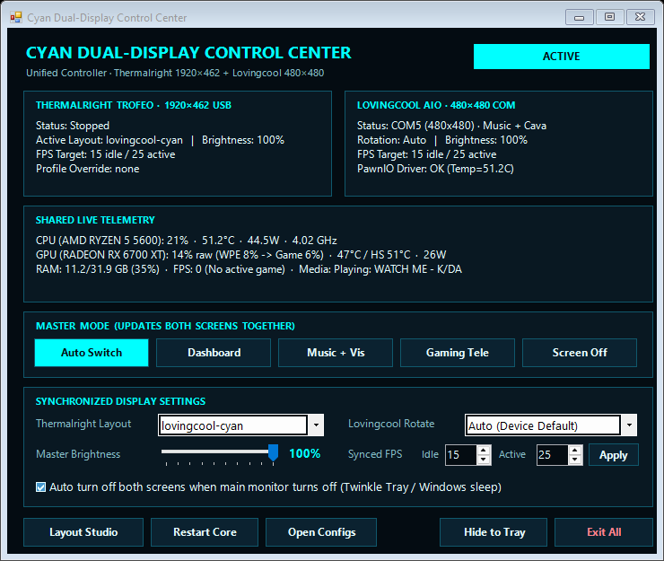
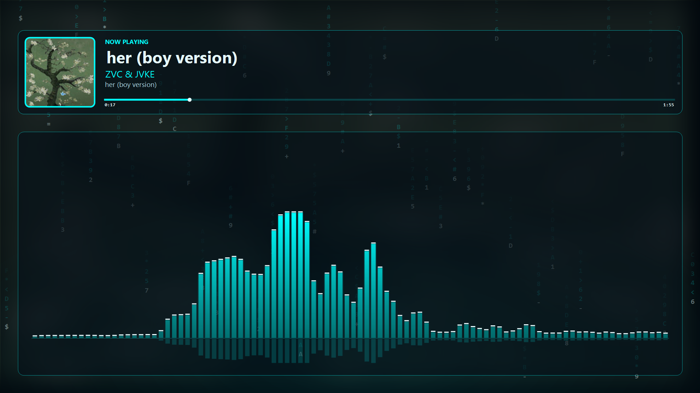
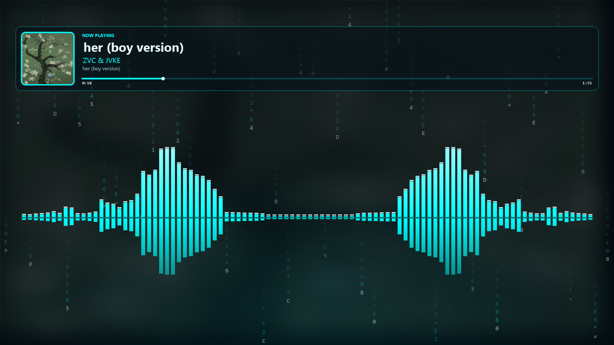
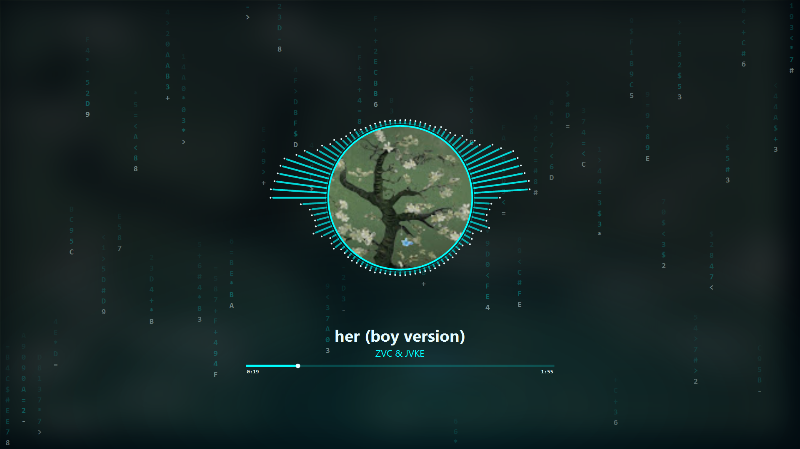

# KuroSuite

A lightweight, native Windows (`#00FFFF` cyberpunk cyan) hardware display and audio visualization suite built in C# (.NET Framework 4.x — zero external runtimes required).

---

## Apps Included

### 1. **KuroHUD** (`KuroHUD/`)
Unified controller for dual case LCD screens + GPU RGB sleep synchronization:
- **Thermalright Trofeo (`1920×462` USB `0416:5408`)** + **Lovingcool AIO (`480×480` USB-CDC serial)** managed from a single tray icon and dark-cyan Control Center (`--ui`).
- **Custom Cyan Matrix HUD (`lovingcool-cyan.layout`)** with circular gauges, synced `15 FPS` idle / `25 FPS` active frame rates, and smooth `550ms` frosted-blur transitions on the Lovingcool display.
- **Accurate Unified Gaming Mode Sync:** Excludes Wallpaper Engine GPU load via PDH and keeps both screens in 1:1 Gaming Mode lockstep without false triggers.
- **Full Unicode / Khmer Music Support:** Automatically detects non-Latin tracks (Khmer, Thai, Japanese, Korean, Chinese, Arabic, etc.) and renders properly shaped track cards via Windows Uniscribe (`TextRenderer`) while keeping live 25 FPS Cava spectrum bars active.
- **Auto Monitor-Sleep Sync (Twinkle Tray / Windows Display Power):** Automatically turns off both case screens **and** your **Sapphire NITRO+ RX 6700 XT** GPU RGB (directly via AMD ADL2 OEM I2C `0x28`, zero SignalRGB conflict) when your main monitor turns off, and restores everything when you wake the monitor.
- **USB Auto-Recovery:** Automatically cycles the stalled USB hub port (`IOCTL_USB_HUB_CYCLE_PORT`) if the Thermalright WinUSB endpoint ever times out.



---

### 2. **KuroBeat** (`KuroBeat/`)
A 60 FPS desktop monitor music visualizer matching the same dark-glass `#00FFFF` cyberpunk aesthetic:
- **Live 96-bar WASAPI Loopback FFT Spectrum** + **Windows Media Session** album art, track info, progress bar, and playback controls.
- **3 Visualizer Styles (`V`):** Cyber Bars (with reflections & peak caps), Mirror Wave, and symmetric Radial Ring around circular album art.
- **4 Color Themes (`M`):** Pure Cyan (`#00FFFF`), Adaptive Album Art, Matrix Green, and Neon Violet.
- **3 Backgrounds (`G`):** Matrix Rain + Cover Glow, Blurred Album Art, or Pure Black (OLED).
- **60 FPS at Native 1440p Fullscreen:** Pre-baked `Format32bppPArgb` background cache, cached album art, and pre-rendered Matrix glyph sprites.
- **Built-in YouTube Music Phone Remote (`kurobeat.local`):** Includes an in-process HTTP + WebSocket server, `kurobeat.local` mDNS responder (port `8765`), mobile PWA UI (`KuroBeat\web\`), and Chrome/Edge extension (`KuroBeat\extension\`) — control playback, queue, search, and Windows master volume directly from your phone over Wi-Fi (`R` opens the QR connect view).
- **Monitor & UX Features:** Multi-monitor snap (`1` / `2`), Fullscreen (`F11` / double-click), Borderless draggable/resizable mode (`B`), Always on Top (`T`), and auto-hiding HUD + mouse cursor after 2.4s idle.

| Cyber Bars | Mirror Wave | Radial Ring |
| :---: | :---: | :---: |
|  |  |  |

---

## Building & Installing from Source (Windows 10 / 11)

No Visual Studio or SDK installation is needed — both apps compile directly with Windows' built-in `.NET Framework 4.x` C# compiler (`csc.exe`):

```powershell
# Clone the repo
git clone https://github.com/Siekpheng/KuroSuite.git
cd KuroSuite

# One-step KuroBeat install (builds KuroBeat\KuroBeat.exe + creates Start Menu shortcut)
powershell -ExecutionPolicy Bypass -File .\KuroBeat\install.ps1

# Or build KuroBeat only (outputs KuroBeat\KuroBeat.exe)
powershell -ExecutionPolicy Bypass -File .\KuroBeat\build.ps1

# Build KuroHUD (outputs KuroHUD\trofeo_lcd.exe)
powershell -ExecutionPolicy Bypass -File .\KuroHUD\build.ps1
```

### YouTube Music Phone Remote Setup (Included in `KuroBeat/`)
1. Run `.\KuroBeat\install.ps1` and launch **KuroBeat** (allow Private network access in Windows Firewall if prompted).
2. In Chrome or Edge on the PC, open `chrome://extensions` (or `edge://extensions`), enable **Developer mode**, click **Load unpacked**, and select the cloned `KuroBeat\extension` folder.
3. Open [music.youtube.com](https://music.youtube.com) on the PC, then open `http://kurobeat.local:8765` on your phone (or press `R` inside KuroBeat for the QR code).

## KuroBeat Keyboard Shortcuts

| Key | Action |
| :--- | :--- |
| `V` | Cycle Visualizer Style (Bars / Mirror / Radial) |
| `M` | Cycle Color Theme (Cyan / Adaptive / Green / Violet) |
| `G` | Cycle Background (Matrix / Cover Blur / Pure Black) |
| `F11` / Double-Click | Toggle Fullscreen |
| `1` / `2` | Move to Monitor 1 or Monitor 2 |
| `B` | Toggle Borderless Window |
| `T` | Toggle Always on Top |
| `H` | Toggle Track Info Card |
| `R` | Show / Open Phone Remote QR Connect |
| `Space` / `←` / `→` | Play/Pause, Previous, Next Track |

## License

MIT License — see [LICENSE](LICENSE).
